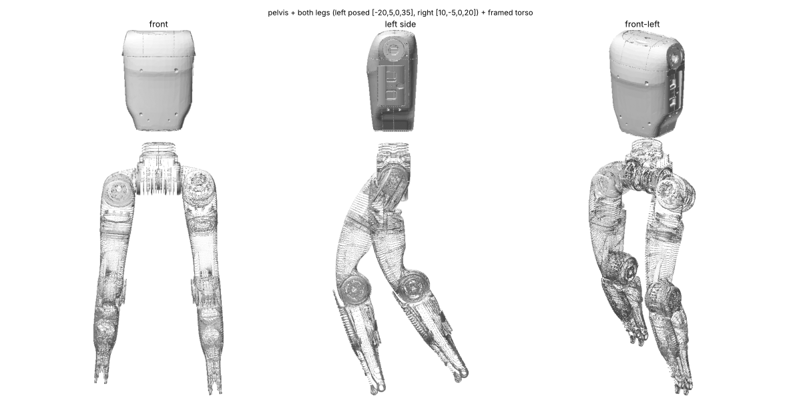

# Legs: pelvis + both legs with the 6512 cycloidal actuators

The left leg was built by `integrate_leg.py` (see `README_python_build.md`). The right leg is its
mirror image in y, made by `mirror_right.py`.

## Files

| File | What it is |
|---|---|
| `legs.scad` | Pelvis + both legs from the finished STLs, posable: `qLeft`, `qRight` = [hip pitch, hip roll, hip yaw, knee] in degrees, G1 URDF sign convention for both legs |
| `../assembly/assembly.scad` | The whole robot now: legs (`qLegL`, `qLegR`, `show_legs`), framed torso, arms |
| `../lib/legs_lib.scad` | The leg modules and G1 joint frames used by both files above |
| `g1_leg_actuators.scad` | Your parametric version. It now has `side = "left" \| "right"` for the four leg parts, and its assembly shows both legs (`both_legs`) |
| `mirror_right.py` | Rebuilds the four `right_*` STLs from the `left_*` ones. Rerun it after `integrate_leg.py` |
| `integrate_leg.py`, `README_python_build.md`, `README_openscad.md`, `section_*.png` | Your originals, unchanged |
| `g1_23dof_Original_left_leg_postions.urdf` | The joint positions used |

**Printable parts** (in `../../STL/legs/`, mm, each in its own G1 link frame):

| Left | Right |
|---|---|
| `left_hip_pitch_link_integrated.stl` | `right_hip_pitch_link_integrated.stl` |
| `left_hip_roll_link_integrated.stl` | `right_hip_roll_link_integrated.stl` |
| `left_hip_yaw_link_knee_integrated.stl` (thigh) | `right_hip_yaw_link_knee_integrated.stl` |
| `left_knee_link_integrated.stl` (shin + push rods) | `right_knee_link_integrated.stl` |
| `pelvis_left_half_integrated.stl` | `pelvis_right_half_integrated.stl` |

The actuator parts, the STEP file and the original actuator zip are in `../../STL/legs/actuator/`.
Print the same actuator for both sides; only the links are mirrored.

## Why mirroring is enough
- **The links:** Unitree's own right-leg meshes are its left-leg meshes mirrored in y. I checked
  this to within 0.1 mm.
- **The joints:** the right-leg URDF joints are the left ones with the y offsets negated, and the
  axes are the same.
- **The actuators:** their bolt patterns (12 inserts, 6 output bolts, 6 pin bolts, 4 stator bolts)
  are evenly spaced. The mirrored pockets therefore take the same, unmirrored actuator, just
  rotated about its axis. The stator floor copied from the motor shell is mirrored too. Its
  4-bolt pattern is symmetric, and the stator can be clocked to suit the wire slots.

## Checked
- **Symmetry:** with mirrored joint angles (left [-30, 12, 8, 60], right [-30, -12, -8, 60]), every
  right-leg vertex lands within 0.0001 mm of the mirrored left leg. That confirms both the right
  STLs and the right-leg joint frames.
- **Mesh quality:** the right parts have the same volumes as the left and outward-facing normals.
  They are watertight because the left parts are.
- **Paths:** every file path in `legs.scad`, `assembly.scad` and `g1_leg_actuators.scad` resolves.
  The one exception is `STL/legs/stock/`, below.

## Before you rely on it
- **Hip yaw:** the STLs are the version where hip yaw is still the stock G1 interface. Your
  `g1_leg_actuators.scad` is newer and builds the hip yaw actuator into the hip roll link and
  thigh, so the two versions differ there.
- **Missing `stock/` folder:** the SCAD needs your cleaned meshes, which weren't in the upload. Copy
  `stock/*.stl` (pelvis, left_hip_pitch_link, left_hip_roll_link, left_hip_yaw_link,
  left_knee_link) into `STL/legs/stock/`. Then render the parts and export them over the STLs, and
  run `mirror_right.py`. Alternatively, `side = "right"` exports the right parts directly.
- **What's not in the assembly yet:**
  - the waist links between the pelvis and the torso (about 40 mm of gap, at zero waist angles)
  - the ankle pitch/roll links and feet
- **Not rendered here:** OpenSCAD isn't installed where this was prepared, so open `legs.scad` once
  before relying on it.
