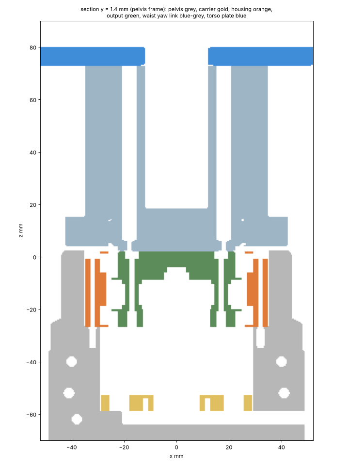

# Legs and waist: pelvis, both legs and the waist yaw joint, all with the 6512 cycloidal actuator

The left leg was built by `integrate_leg.py` (see `README_python_build.md`). The right leg is its
mirror image in y, made by `mirror_right.py`.

## Files

| File | What it is |
|---|---|
| `legs.scad` | Pelvis + both legs from the finished STLs, posable: `qLeft`, `qRight` = [hip pitch, hip roll, hip yaw, knee] in degrees, G1 URDF sign convention for both legs |
| `../assembly/assembly.scad` | The whole robot now: legs (`qLegL`, `qLegR`, `show_legs`), framed torso, arms |
| `../lib/legs_lib.scad` | The leg modules and G1 joint frames used by both files above |
| `g1_leg_actuators.scad` | Your parametric version. It now has `side = "left" \| "right"` for the four leg parts, and its assembly shows both legs (`both_legs`) |
| `mirror_right.py` | Rebuilds the four `right_*` STLs from the `left_*` ones. Rerun it after `integrate_leg.py` |
| `integrate_leg.py`, `README_python_build.md`, `README_openscad.md`, `section_*.png` | Your originals, unchanged |
| `g1_23dof_Original_left_leg_postions.urdf` | The joint positions used |
| `waist/` | The waist yaw joint: `gen_waist.py` (builds the parts), `check_waist.py` (interference checks + section), reports |

**Printable parts** (in `../../STL/legs/`, mm, each in its own G1 link frame):

| Left | Right |
|---|---|
| `left_hip_pitch_link_integrated.stl` | `right_hip_pitch_link_integrated.stl` |
| `left_hip_roll_link_integrated.stl` | `right_hip_roll_link_integrated.stl` |
| `left_hip_yaw_link_knee_integrated.stl` (thigh) | `right_hip_yaw_link_knee_integrated.stl` |
| `left_knee_link_integrated.stl` (shin + push rods) | `right_knee_link_integrated.stl` |
| `pelvis_left_half_waist.stl` | `pelvis_right_half_waist.stl` |

Pelvis halves: print the `_waist` versions. The `_integrated` ones are the earlier leg-only build. `waist/gen_waist.py` reads them as its input.

The actuator parts, the STEP file and the original actuator zip are in `../../STL/legs/actuator/`.
Print the same actuator for both sides; only the links are mirrored.

## Why mirroring is enough
- **The links:** Unitree's own right-leg meshes are its left-leg meshes mirrored in y. I checked
  this to within 0.1 mm.
- **The joints:** the right-leg URDF joints are the left ones with the y offsets negated, and the
  axes are the same.
- **The actuators:** their bolt patterns (12 inserts, 6 output bolts, 6 pin bolts, 4 stator bolts)
  are evenly spaced. The mirrored pockets therefore take the same, unmirrored actuator, just
  rotated about its axis. The stator floor copied from the motor shell is mirrored too. Its
  4-bolt pattern is symmetric, and the stator can be clocked to suit the wire slots.

## Checked
- **Symmetry:** with mirrored joint angles (left [-30, 12, 8, 60], right [-30, -12, -8, 60]), every
  right-leg vertex lands within 0.0001 mm of the mirrored left leg. That confirms both the right
  STLs and the right-leg joint frames.
- **Mesh quality:** the right parts have the same volumes as the left and outward-facing normals.
  They are watertight because the left parts are.
- **Paths:** every file path in `legs.scad`, `assembly.scad` and `g1_leg_actuators.scad` resolves.
  The one exception is `STL/legs/stock/`, below.

## Before you rely on it
- **Hip yaw:** the STLs are the version where hip yaw is still the stock G1 interface. Your
  `g1_leg_actuators.scad` is newer and builds the hip yaw actuator into the hip roll link and
  thigh, so the two versions differ there.
- **Missing `stock/` folder:** the SCAD needs your cleaned meshes, which weren't in the upload. Copy
  `stock/*.stl` (pelvis, left_hip_pitch_link, left_hip_roll_link, left_hip_yaw_link,
  left_knee_link) into `STL/legs/stock/`. Then render the parts and export them over the STLs, and
  run `mirror_right.py`. Alternatively, `side = "right"` exports the right parts directly.
- **What's not in the assembly yet:** the ankle pitch/roll links and feet.
- **Not rendered here:** OpenSCAD isn't installed where this was prepared, so open `legs.scad` once
  before relying on it.

## Waist yaw joint (same 6512 actuator)

The G1 23-DoF model has one waist joint: **yaw**, about the pelvis z axis. Roll and pitch are
locked, so the G1's roll/pitch linkage (waist roll link, constraint rods, support link) isn't
needed. This joint uses the same actuator as the hips. The G1 waist yaw limit is 88 N·m, the same
as the hip pitch and roll, so the motor needs the same ~5.9 N·m at 15:1.

| Part | What it is |
|---|---|
| `pelvis_{left,right}_half_waist.stl` | The pelvis with the actuator built into its top disc (where the G1 keeps its waist motor). Rings and 12 heat-set inserts as on the hips, output face flush with the pelvis top (z = 2.2 mm), facing up. |
| `waist_stator_carrier.stl` | Drop-in stator floor: your motor-shell floor plus an outer ring. 4 × M3 countersunk screws on the spokes go into inserts in the pelvis. |
| `waist_yaw_link_integrated.stl` | The G1 waist yaw disc (Ø85) with a Ø70 riser up to the torso bottom plate. Boss + 6 × M3 on the 36 mm circle to the output, hex-key bores from the riser top, 6 × M4 heat-set inserts on a 50 mm circle for the torso plate. |
| `../../STL/torso_frame/bottom_plate.stl` | Updated: waist bolt circle moved onto the yaw axis (torso x = +3.96 mm), two Ø14 cable holes at y = ±48 mm. |

**Why there's a separate stator carrier.** On the legs the stator is screwed to a floor from
behind, through an access opening. Behind the waist floor there's only solid pelvis, with the hip
actuators below it. So the floor is a separate disc: screw the stator to it on the bench, then drop
it in.

**Changed on the pelvis.**
- **Moved joining hardware:** two joining bolts (`[±20, -38]`) and both dowels (`[±30, -50]`) sat
  where the pocket goes. They're now at `[±40, -40]` and `[±41, -52]` (`JOIN_BOLTS` / `JOIN_DOWELS`
  in `g1_leg_actuators.scad`). The old holes are filled. The other two bolts are unchanged.
- **Wires:** the stator wires leave the space under the carrier through a 12 × 5 mm channel out
  of the front of the pelvis.

**Checked** (`waist/waist_checks.json`):
- **Pocket:** the actuator housings and output sit in the pocket with no overlap beyond the 0.2 mm
  ring clearance.
- **Waist link:** it clears the pelvis, carrier and stationary rings at 0°, ±45°, 90° and ±150°
  of yaw.
- **Torso plate:** the riser top meets the plate underside exactly (z = 73.0 mm). The torso skin
  stays at least 52.7 mm from the yaw axis, so the Ø85 disc and Ø70 riser turn freely inside it.
- **Walls:** the pocket keeps at least 3 mm of wall to every other cavity. The nearest is the
  original back joining bolt, 5.5 mm away.
- **Rest of the pelvis:** away from the waist, the new halves match your originals to a median of
  0.000 mm (99 % within 0.15 mm). Sharp corners are rounded by a few tenths of a millimetre from the
  0.6 mm sampling, and one ~0.3 mm hairline slit left over from the original booleans got filled.

**Assembly order (waist)**
1. Join the pelvis halves as before (`[±40, -40]` and `[±41, -52]` replace the two inner bolts and
   the dowels).
2. Melt 12 M3 inserts into the ring counterbore and 4 into the carrier seat.
3. Screw the stator to the carrier on the bench, feed the wires down, and drop it in. Fit
   4 × M3 × 10 countersunk screws.
4. Build the rest of the actuator into the pocket as on the hips.
5. Bolt the waist yaw link to the output: 6 × M3 down the bores in the riser.
6. Melt 6 M4 inserts into the riser top. Lower the torso onto it and fit 6 × M4 × 14 from inside the
   torso (between the trays).

**Viewing it.** In `assembly.scad` and `legs.scad`, `qWaist` turns the torso. To rebuild the parts
after changing a parameter, run `python waist/gen_waist.py` (about 2 minutes), then
`python waist/check_waist.py`. The same parameters are in `g1_leg_actuators.scad`
(`part = "waist_yaw_link"` / `"waist_stator_carrier"`, and the pelvis halves include the pocket).

**Still to do.**
- **Cables:** the torso-to-pelvis loop past the riser has no clips or routing yet.
- **Untested here:** the SCAD changes haven't been rendered. Check them once with your `stock/`
  folder in place.
- **Simulator:** the humanoid-gym model still has the 29-DoF waist (yaw, roll, pitch).
