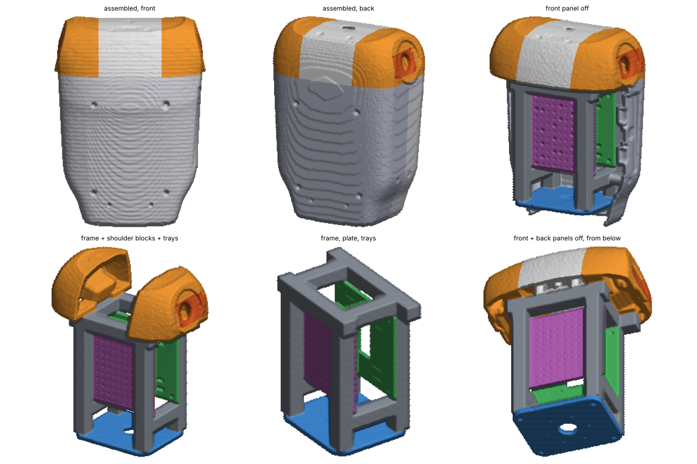

# Open G1 torso on a 2020 aluminium frame

The one-piece torso (150 × 215 × 320 mm, mostly solid) is replaced by a **2020 aluminium frame**
carrying **printed parts that each fit a 220 × 220 × 250 mm bed**. The outside is still the original
`torso_link_rev_1_0` shape: the printed parts are cut from your torso STL's own outer surface.



## Parts

| Printed part | Size (mm) | What it does |
|---|---|---|
| `front_panel` | 79 × 215 × 219 | chest + belly skin, 6 × M5 into the frame, 2 × M3 into the plate |
| `back_panel` | 70 × 215 × 219 | back skin, same fixings |
| `top_panel` | 145 × 89 × 69 | between the shoulders; socket for the head; 4 pillars bolt to the crossbars |
| `shoulder_block_L/R` | 141 × 62 × 72 | shoulder housings with the DS3235 shoulder-pitch servo pockets (same as before); 4 × M5 into the crossbars |
| `hatch_L/R` | 63 × 19 × 38 | servo hatches, unchanged from the one-piece torso |
| `bottom_plate` | 107 × 126 × 7 | posts screw into it from below; waist interface underneath |
| `compute_tray` | 124 × 114 × 4 | on the back posts. Slots take a Raspberry Pi 5 (58 × 49) or a board with 86 mm hole spacing (e.g. Jetson Orin Nano dev kit; **check your board**) |
| `driver_tray` | 124 × 114 × 4 | on the front posts. 10 mm grid of Ø2.9 holes for servo/motor driver boards (M3 self-tapping or M2.5 + nut) |

- **How the panels are made:** the original torso is filled in, the stock head collar is subtracted
  with 0.5 mm clearance (that's the head socket), and it's hollowed to a 3 mm skin (4 mm for the
  shoulder blocks, plus 5 mm round each servo pocket). It's then split at x = 4 mm (front/back),
  z = 220 mm (top of the crossbars) and |y| = 45 mm (top panel / shoulder blocks), with 0.5 mm seams.
- **Checked:**
  - **Shape:** 94–95 % of the outer-surface points of the front and back panels are within 0.05 mm
    of your original triangles (85–89 % for the top panel and shoulder blocks), with a median of
    0.00 mm. The rest are the screw countersinks, seams, servo openings and the head socket.
  - **No clashes:** no printed part overlaps another or the aluminium.
  - **Removal:** the front panel slides off forwards, the back panel backwards, and the top panel
    and shoulder blocks lift straight up, without hitting the frame, trays or plate.
  - **Clearance:** the frame is at least 5.5 mm inside the outer surface everywhere (the skin is 3 mm).
- **Weight:** 2.03 kg without electronics: 1.05 kg printed (at 1.1 g/cm³, since 3–4 mm walls
  print almost solid), 0.61 kg of 2020, 2 servos and 0.25 kg of fasteners and brackets
  (`torso_mass.json`).
- **Gone:** the solid blocks inside the original torso (Unitree's internal placeholders). That
  space is now the frame plus about 55 mm of room front-to-back for electronics.

## Aluminium (2020, slot 6), 1.22 m total

| Qty | Length | Piece |
|---|---|---|
| 4 | 164 mm | posts (front x = 44, back x = −39, y = ±52). **Tap M5 in the bottom end of each.** |
| 1 | 140 mm | front crossbar (z 200–220) |
| 1 | 170 mm | back crossbar (z 200–220) |
| 4 | 63 mm | side rails: 2 at the top between the crossbars, 2 low (z 60–80) between the posts |

## Hardware

| Qty | Part | Where |
|---|---|---|
| 12 | 2020 inside corner bracket (L, slot 6) + 2 × M5×8 + 2 T-nuts each | post tops → crossbars (4), top rails → crossbars (4), low rails → posts (4) |
| ~60 | M5 drop-in T-nut, slot 6 | panels 12, top panel 4, shoulder blocks 8, trays 8, brackets 24 |
| 2 + 1 + 1 + 2 | M5 countersunk (ISO 10642) ×16, ×25 (upper left), ×30 (upper right), ×35 | front panel |
| 2 + 2 + 2 | M5 countersunk ×12, ×20, ×35 | back panel |
| 2 / 2 | M3 countersunk ×14 / ×10 | front / back panel → plate edge |
| 4 | M3 heat-set insert Ø4 × 5.7 | plate edge |
| 4 | M5 countersunk ×16 | plate → tapped post ends |
| 4 | M5 socket cap ×14 | top panel pillars → crossbars |
| 8 | M5 socket cap ×12 | shoulder blocks → crossbars |
| 8 | M5 button head ×8 | trays → posts |
| 4 | M3 socket cap ×16 + 4 M3 heat-set inserts in the head | head → top panel |

Each panel screw length is chosen to reach 3.5–6 mm past the aluminium face (into the T-nut, not
into the extrusion core). The upper-left front screw sits 1.8 mm below the surface to manage that.
`generator/work/report.json` lists every screw (it is created when you run the generator).

## Assembly order
1. Screw the 4 posts onto the bottom plate (countersunk M5×16 from below into the tapped ends).
2. Fit the low side rails between the front and back posts (24 mm above the plate) with corner brackets.
3. Fit the crossbars on the post tops and the top rails between them, with brackets on the inside corners.
4. Shoulder servos into the shoulder blocks, as before (hatch screws from outside). Drop T-nuts into the
   crossbar top slots and bolt each block down: 2 × M5×12 per crossbar, reached from the open inner side.
5. Top panel: T-nuts in the crossbars, 4 × M5×14 down through the pillars from above.
6. Head: melt the 4 M3 inserts into the collar (the updated `head.scad` has the holes). Sit the head in
   the socket and screw it from inside the torso, up through the top panel (4 × M3×16).
7. Electronics onto the trays, then the trays onto the posts. The head cable comes down through the
   Ø20 mm hole under the head bore.
8. Put T-nuts in the post faces and low-rail outer slots, and heat-set the plate-edge inserts. Then fit
   the back and front panels.

## Waist
The plate underside has a **placeholder** waist interface: 6 × Ø4.5 holes on a 60 mm circle and a
Ø26 mm cable hole, centred under the waist pitch axis. Change `WAIST_*` in `generator/layout.py` once
the waist actuator is designed.

## Printing
- **Material:** PETG or PLA+.
- **Walls:** use 4 perimeters (0.45 mm lines), so the 3 mm walls print solid.
- **Front and back panels:** print them standing on their bottom edge, with supports only under the
  side bosses.
- **Untested:** these orientations are suggestions; I haven't printed them.

## Files
- `torso_frame.scad`: frame + printed parts. `PART = "assembly" | "exploded" | "frame" | <part name>`.
  `../assembly/assembly.scad` uses it (through `../lib/torso_frame_lib.scad`) (`torso_style = "framed"`); set `"solid"` for the old one-piece torso.
- `../../STL/torso_frame/`: printed parts, in mm, in the torso_link frame (place them as they are in the assembly).
- `generator/`: change `layout.py` (every dimension above), then run from that folder:
  ```bash
  export G1_HEAD_STL=/path/to/unitree/head_link.STL     # the stock collar becomes the head socket
  python env.py 0.5 && python gen_torso.py && python outer_sdf.py && python export.py && python mass.py && python make_scad.py && python check.py
  ```
  It takes about 7 minutes and needs about 6 GB of RAM. It reads `STL/torso/` and `OpenScad/generator/design.py`, and writes `STL/torso_frame/` and the two torso frame .scad files.
- `checks.json`: the clearance, overlap, removal and surface-accuracy results above.
- `../head/head.scad`: your head with the 4 neck insert holes added.
- **Not done here:** OpenSCAD isn't installed, so render `torso_frame.scad` once before relying on it.
  No stress analysis was done.
