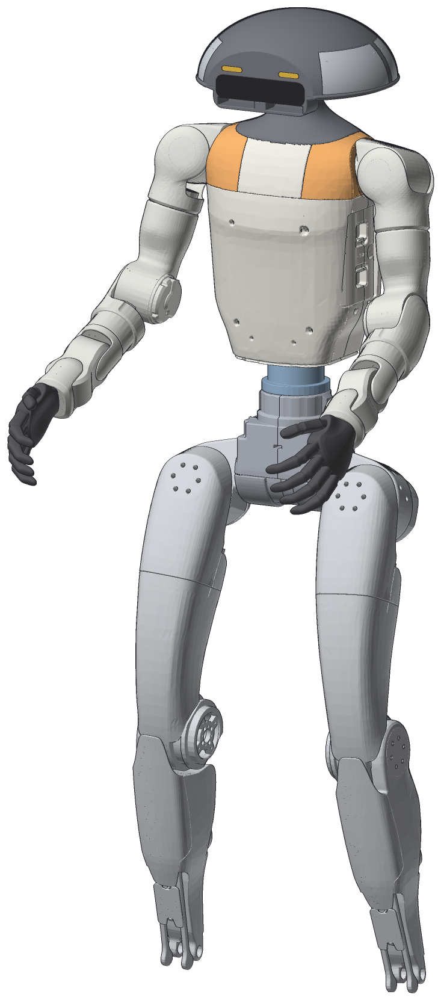
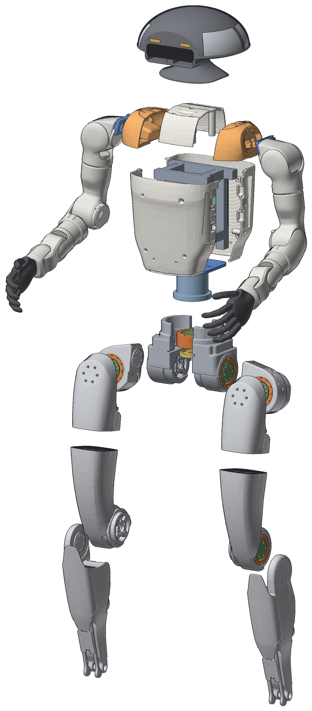
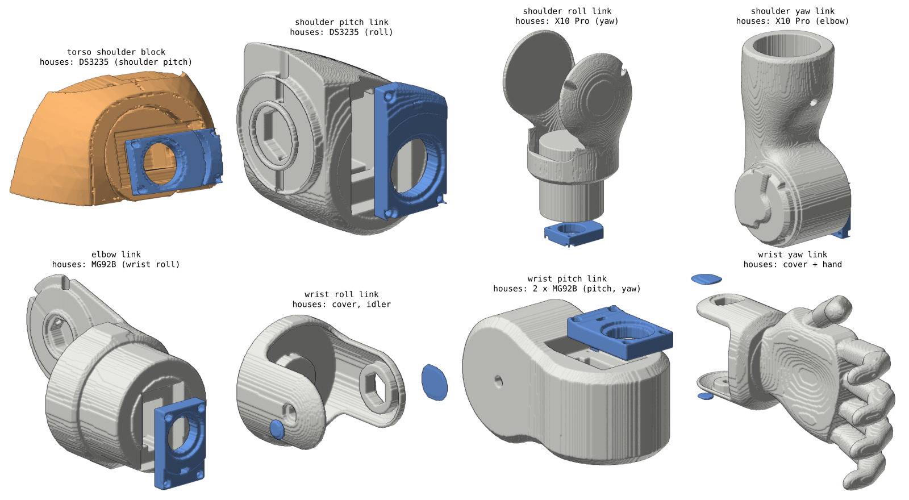

# OpenG1 – a 3D-printable humanoid

OpenG1 is a printable humanoid built on the **Unitree G1's shape and kinematics**. Every link
starts from the original G1 mesh, and the joint axes and link frames match the G1 URDF. So
policies and tools written for the G1 (pose copying, teleoperation, RL) carry over.

- **Legs and waist:** 3D-printed 6512 cycloidal actuators (Berkeley Humanoid Lite design), built
  into the links.
- **Arms and shoulders:** off-the-shelf hobby servos, hidden inside the original link shapes.
- **Torso:** printed panels on a 2020 aluminium frame. The head is a printed dome with a RealSense D455.



- **Simulation:** [open3dhumanoid/humanoid-gym](https://github.com/open3dhumanoid/humanoid-gym) (MuJoCo + Gymnasium)
- **Design files:** OpenSCAD. Each subsystem is generated from one Python description, which also
  runs the fit and collision checks.

## What's in this repo

```
OpenScad/
  assembly/assembly.scad   # the whole robot, posable: qL / qR (arms), qLegL / qLegR (legs), qWaist
  parts_left/ parts_right/ # one file per printable arm part per side: open, F6, export STL
  parts_torso/             # the old one-piece torso + its shoulder hatches (superseded by torso_frame/)
  torso_frame/             # torso on a 2020 aluminium frame: torso_frame.scad, README, generator/
  hardware/                # printed servo hubs and idler pins
  head/head.scad           # dome head with the RealSense D455, removable panels, servo brows
  legs/                    # pelvis, both legs, waist yaw joint: legs.scad, g1_leg_actuators.scad,
                           #   integrate_leg.py, mirror_right.py, waist/ (gen_waist.py, check_waist.py)
  generator/               # design.py (every arm/shoulder joint feature) + emit.py (writes lib/ and assembly/)
  lib/                     # g1_servo_arm.scad, torso_frame_lib.scad, legs_lib.scad (included by the files above)
STL/
  arms/                    # G1 arm link STLs, fixed shoulder roll link, cleaned rubber hands
  torso/                   # G1 torso split into bodies + voxel fallback (source for torso_frame)
  torso_frame/             # printed torso parts
  head/                    # Unitree head_link.STL (stock collar) + exported head parts
  legs/                    # leg parts (left + mirrored right), pelvis halves, waist parts,
                           #   stock/ (cleaned G1 meshes), actuator/ (6512 STLs, STEP)
  torso_waist_parts_unmodified/
Assets/                    # renders used in this README and the build guide
```

**Opening the files.** Open any `.scad` file from inside its own folder (File → Open). Every file you
open sits one folder below `OpenScad/`, and every mesh path is `../../STL/...` relative to it.
Keep that layout. If a file can't be found, OpenSCAD only prints a warning in the console and
shows an empty view.

## How the robot is built

| Subsystem | Actuators | Files | Details |
|---|---|---|---|
| Arms (7-DoF each) | DS3235 (shoulder roll), 2 × X10 Pro (shoulder yaw, elbow), 3 × MG92B (wrist) | `parts_left/`, `parts_right/`, `hardware/` | below |
| Torso | 2 × DS3235 (shoulder pitch) in the shoulder blocks | `torso_frame/` | `OpenScad/torso_frame/README.md` |
| Head | 2 × SG90 (brows), RealSense D455 | `head/head.scad` | in the file header |
| Pelvis + legs | 6512 cycloidal: hip pitch, hip roll, knee per leg | `legs/` | `OpenScad/legs/README.md` |
| Waist yaw | the same 6512 actuator, in the pelvis top | `legs/waist/` | `OpenScad/legs/README.md` |



## Design approach

1. **Start from the G1 meshes.** Every link starts as the original G1 STL. The outside shape is kept:
   - **Arms:** the original mesh is imported unchanged.
   - **Torso panels:** cut from the original surface. 94–95 % of their outside lies within 0.05 mm
     of the G1 torso.
   - **Pelvis and legs:** come from the leg-integration build.
2. **Cut, don't add.** Each joint gets a pocket for its actuator. Where a pocket opens to the
   outside, the removed piece comes back as a **hatch** that screws on. Material is only added where
   a wall would be thinner than 3 mm, and it's clipped to the original outline.
3. **Verify.** Each generator checks its own parts:
   - **Fit:** every actuator sits fully inside its link.
   - **Single pieces:** every part comes out as one piece.
   - **Collisions:** every joint is swept through its G1 range.
   - **Frame and waist:** the torso frame and the waist are checked for clearances, overlaps and
     removal paths.



## Actuators

| Joint | Actuator | Torque | Sits in |
|---|---|---|---|
| Hip pitch, hip roll, knee | 6512 printed cycloidal, 15:1 | G1 limits 88 / 88 / 139 N·m | pelvis, hip pitch link, thigh |
| Hip yaw | 6512 (in `g1_leg_actuators.scad`; the STLs still have the stock interface) | 88 N·m | hip roll link |
| Waist yaw | 6512 | 88 N·m | pelvis top |
| Ankle pitch + roll | 2 × 6512 per leg in the shin, G1-style cranks and push rods (`OpenScad/legs/ankle/`) | ~39 N·m at the ankle | shin |
| Shoulder pitch | DS3235 (40 × 20 × 38.5 mm), built in under a hatch, 6807 bearing round the output | 35 kg·cm @ 7.4 V | torso shoulder block |
| Shoulder roll | DS3235 in a **cartridge**, plus a 608 in the fork's far arm | 35 kg·cm | shoulder pitch link |
| Shoulder yaw | KST X10 Pro (30 × 10 × 33.5 mm) in a **cartridge** | 11.5 kg·cm | shoulder roll link |
| Elbow | KST X10 Pro in a **cartridge** | 11.5 kg·cm | shoulder yaw link |
| Wrist roll | TowerPro MG92B (22.8 × 12 × 31 mm) in a **cartridge** | 3.5 kg·cm @ 6 V | elbow link |
| Wrist pitch + yaw | 2 × MG92B | 3.5 kg·cm | wrist pitch link |
| Brows | 2 × SG90 | – | head |

### Servo cartridges (arm joints)
The shoulder roll, shoulder yaw, elbow and wrist roll servos sit in **cartridges**: round printed
housings that slide into a round bore in the link and screw in. The servo sits inside, with its output on the
joint axis. To fit a different motor later, make a new cartridge with the same outside.

**Two points of contact.** Each cartridge has a thin ring bearing in its nose (6807 for the DS3235, 6805 for
the X10 Pro and MG92B). The child link has a spigot that runs in the bearing, so the joint is carried by the
bearing as well as the servo output. The shoulder roll is a fork, so it also gets a 608 bearing in the far
arm: it sits in the cartridge's rear cap, with an 8 × 16 mm steel dowel pressed into the roll link. The
wrist pitch and yaw were already supported on both sides by their idler pins.

**Fitting a cartridge:**

| Joint | Loads from | Held by | Notes |
|---|---|---|---|
| Shoulder yaw, elbow, wrist roll | The joint face | 3 lugs, M2.5 into heat-set inserts | The cap screws on the back with 2 × M2.5 × 6 |
| Shoulder roll | The far face (the fork arms block the near one) | The rear cap: 2 × M3 button heads into the link, 2 × M2.5 × 10 into the cartridge | The cap carries the 608 |

Cut the mounting tabs off the DS3235 and MG92B: the cartridge clamps the case between its front shoulder
and the cap instead.

**What changes on the outside:**
- **Shoulder yaw:** the upper arm gets a sleeve where the X10 Pro cartridge sits (about 56 mm across instead of
  44–48 mm), plus a face flange for the lugs.
- **Shoulder roll:** the cartridge has a flat on its torso side, which clears the shoulder-pitch hex socket and
  stops it rotating. Its cap flange covers the rounded edge of the far face.

**The shoulder pitch stays built in:** a DS3235 cartridge is 68 mm across but the torso's shoulder socket is
62 mm. From inside the torso, the 2020 top rail and crossbars block the way in. It does get the 6807 round its
output, with the seat in the (now larger) servo hatch.

**Printing:** print the cartridges back face down, so the bearing seat opens upwards with no overhang,
and the roll cap outer face down.

**Regenerating:** the cartridge geometry is in `OpenScad/generator/design.py` (`cartridge_joint`), and
`emit.py` writes the parts. The checks, run from `OpenScad/generator/`:

| Script | Checks |
|---|---|
| `check_cartridges.py` | Wall left round each bore, inserts in solid material, clashes with the other joints' cuts |
| `check_attach.py` | Every spigot ring is rooted in solid material (more than 92% of its base), so nothing prints as a floating layer |
| `check_screws.py` | Every child-to-hub screw comes out on the outside of the link |

The original shoulder-yaw mesh is three solids in one file, which OpenSCAD's CGAL engine drops. `split_shells.py`
splits it into `STL/arms/*_shoulder_yaw_link_shell*.stl`, and the library unions them.

The 6512 needs about 5.9 N·m at the motor (15:1, before losses) to reach the G1's 88 N·m hip and
waist limits, and about 9.3 N·m for the 139 N·m knee. Check these against your motor's datasheet.
The servo arms need roughly 1.3 N·m at the shoulder when held straight out, or 2.6 N·m with
300 g in the hand.

## Bill of materials (summary)

| Item | Qty |
|---|---|
| 6512 cycloidal actuator (motor, B-G431B-ESC1, AS5600, bearings, printed parts) | 7 (9 with hip yaw) |
| DS3235 servo (270° version recommended) | 4 |
| KST X10 Pro servo | 4 |
| TowerPro MG92B servo | 6 |
| SG90 micro servo (brows) | 2 |
| Round metal servo horns | 14 |
| 6807 bearing (35 × 47 × 7): shoulder roll + shoulder pitch | 4 |
| 6805 bearing (25 × 37 × 7): shoulder yaw, elbow, wrist roll | 6 |
| 608 bearing + 8 × 16 mm steel dowel (shoulder roll far arm) | 2 + 2 |
| M2.5 heat-set inserts + M2.5 × 8 / × 6 / × 10 screws (cartridge lugs and caps) | ~26 |
| Intel RealSense D455 | 1 |
| 16-channel servo driver (e.g. PCA9685): the 14 arm/shoulder servos + 2 brows | 1 |
| Compute board (Raspberry Pi 5 or Jetson Orin Nano class) | 1 |
| 2020 aluminium extrusion, slot 6 | 1.22 m (10 pieces, cut list in `torso_frame/README.md`) |
| 2020 inside corner brackets | 12 |
| M5 drop-in T-nuts | ~60 |
| M3 heat-set inserts (actuator rings, carrier, pelvis, head, plate) | ~120 |
| M4 heat-set inserts (waist riser) | 6 |
| M3 / M4 / M5 screws, M2 / M3 self-tappers | see the subsystem READMEs |
| 4 mm dowel pins (pelvis) | 2 |
| Filament (PLA or PETG; PETG for hubs) | ~7.5 kg as the files stand (the leg STLs are solid; less once shelled) |

## Printing and assembly

1. **Export the parts.** Open each file in `parts_left/`, `parts_right/`, `hardware/` and
   `torso_frame/`, press F6 and export the STL. The leg, pelvis and waist parts are already final
   STLs in `STL/legs/`, and the head parts are in `STL/head/`. Use OpenSCAD 2024+ with the Manifold
   backend (Preferences → Features → manifold).
2. **Check your servos.** Measure the shaft offset, horn diameter and horn height on the servos you
   bought and compare them with `SERVO` in `OpenScad/generator/design.py`. If they differ, run
   `python OpenScad/generator/emit.py` to regenerate the arm files.
3. **Print.** Print hatches and caps in the same material as their link, so the seam is invisible.
   Print hubs in PETG, hex end down.
4. **Build the subsystems:**
   - **Frame and torso:** follow the assembly order in `OpenScad/torso_frame/README.md`.
   - **Legs and waist:** follow `OpenScad/legs/README.md` and `README_python_build.md`.
5. **Assemble each arm joint:**
   1. Drop the servo through the joint face.
   2. Screw the hub to the servo horn from the horn side.
   3. Fit the horn and hub onto the spline at the servo's centre angle, and fit the centre screw.
   4. Screw the hatch back on.
   5. Slide the child link onto the hex and fit the radial screws.
   6. **Wrist covers only:** fit the pitch link into the cover first. Then put the hub in through
      the cover from outside, fit the idler pin on the opposite side, and glue the cosmetic caps
      over both.
6. **Pose the assembly.** `OpenScad/assembly/assembly.scad` shows the whole robot. Set `qL` / `qR`
   (arms), `qLegL` / `qLegR` (legs) and `qWaist`.

## Regenerating

| What | Run | Writes |
|---|---|---|
| Arm and shoulder joints | `OpenScad/generator/emit.py` (edit `design.py`) | `lib/g1_servo_arm.scad`, `assembly/assembly.scad` |
| Framed torso | `OpenScad/torso_frame/generator/` (edit `layout.py`; commands in its README) | `STL/torso_frame/`, `torso_frame.scad`, `lib/torso_frame_lib.scad` |
| Left leg + pelvis | `OpenScad/legs/integrate_leg.py` (needs trimesh, manifold3d) | `STL/legs/left_*`, `pelvis_*_integrated` |
| Right leg | `OpenScad/legs/mirror_right.py` | `STL/legs/right_*` |
| Waist | `OpenScad/legs/waist/gen_waist.py`, then `check_waist.py` | `STL/legs/pelvis_*_waist`, `waist_*` |

## Simulation

[humanoid-gym](https://github.com/open3dhumanoid/humanoid-gym) has two MuJoCo models with
Gymnasium environments:
- `open_g1.xml`: the full G1 29-DoF robot (`OpenG1-Stand-v0`).
- `open_g1_upper.xml`: the robot above the hips (`OpenG1UpperBody-Reach-v0`).

Both use the framed torso, the servo arms (with servo torque and travel limits) and the dome head
with a D455 camera. The leg and waist models still use the G1's own parameters for now.

## Status

- [x] Torso + 7-DoF servo arms: design files and checks
- [x] Torso on a 2020 frame, printable on a 220 × 220 × 250 bed
- [x] Dome head with D455, brows and neck fixings
- [x] Legs with 6512 actuators at hip pitch, hip roll and knee; right leg mirrored
- [x] Waist yaw actuator (same 6512; the 23-DoF G1 locks waist roll and pitch)
- [ ] Hip yaw actuator in the STLs (it's in `g1_leg_actuators.scad`, which needs `STL/legs/stock/`)
- [ ] Ankles and feet
- [ ] OpenSCAD render check of every file (please report any errors)
- [ ] Cable routing between links and across the waist
- [ ] Leg and waist actuator parameters in the simulator

## Credits

- **Unitree Robotics:** G1 meshes and URDF (`unitree_ros/robots/g1_description`). Check Unitree's
  licence for redistribution of the meshes.
- **Berkeley Humanoid Lite:** the printed cycloidal actuator used for the legs and waist
  ([paper](https://arxiv.org/abs/2504.17249), [design files](https://lite.berkeley-humanoid.org)).

## Making the STLs (Python)

Every printable part is made by a Python generator. Each writes its STLs through
`OpenScad/pyparts/solid.py`, which:
- fills sealed air pockets;
- deletes crumbs;
- joins pieces that touch or nearly touch (Unitree's meshes are often several bodies), and stops with an error
  that says where a piece is if it can't be joined;
- reads every STL back and checks it is **one closed piece**.

OpenSCAD is still there for viewing (`assembly/assembly.scad`, the per-part files) and for the head.

| Parts | Generator (run from its folder) | Output |
|---|---|---|
| Arm links, wrist plugs and caps, servo cartridges and caps, hubs | `OpenScad/generator/build_arm_stls.py` (about 20 min) | `STL/arms_print/` |
| Leg links (6512 actuators) | `OpenScad/legs/integrate_leg.py` (your build) | `STL/legs/` |
| Pelvis halves, waist yaw link, stator carrier | `OpenScad/legs/waist/gen_waist.py` | `STL/legs/` |
| Shin with the ankle drive, foot, crank | `OpenScad/legs/ankle/gen_ankle.py`, then `mirror_right.py` | `STL/legs/` |
| Framed torso panels, blocks, hatches, trays | `OpenScad/torso_frame/generator/` (`gen_torso.py`, then `export.py`) | `STL/torso_frame/` |

`python export_stls.py` gathers them all into `STL_export/<group>/` with their print names, and renders
only the head with OpenSCAD. `--openscad-arms` uses the old OpenSCAD route for the arms instead.

The servos (arms) and the 6512 actuators (legs) all sit in round housings that bolt into round seats,
so either can be swapped later. The shoulder pitch is the exception: its servo sits under a hatch,
because a cartridge can't get past the torso's shoulder socket.
