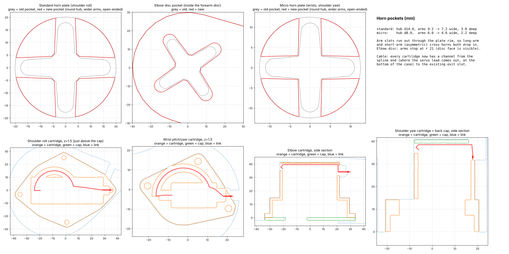

# OpenG1 arm: servo actuators

These are the G1 arm links rebuilt from the stock Unitree meshes to take hobby-servo actuators. The outside shape of each link is the G1 shape. Only these have changed: internal pockets, faces hidden under a mating link, screw holes and cable holes.

Every STL is in millimetres, watertight and a single shell, with consistent normals.

```
left/links/        7 arm links in their G1 link frame (orient them in the slicer yourself)
left/actuators/    one folder per joint; parts are already oriented flat-face-down for printing
right/...          mirror of left, built from the right-hand stock meshes
fit_tests/         print these first (horn pockets)
```



## Servos, following the G1 layout

| Joint | Servo goes in | Servo | Notes |
|---|---|---|---|
| Shoulder pitch | Torso shoulder block (your existing pocket) | Standard 40×20 | The arm side is `shoulder_pitch_hornhub` plus a hex socket in the pitch link. |
| Shoulder roll | Pitch link | **Standard 40×20, 35 kg·cm** (DS3235) | Yoke: horn plate in the front ear, **6803** on the back. |
| Shoulder yaw | Roll-link bottom cylinder | Micro 23×12, strongest you can get | Front **6805** bearing around the horn plate. |
| Elbow | Upper-arm (yaw-link) lobe | Standard 40×20 (DS3218 / DS3235) | Horn screws straight into a horn-shaped pocket in the elbow disc. |
| Wrist roll | Forearm end | Micro 23×12 (MG90S / MG92B) | Front **6805** bearing around the horn plate. |
| Wrist pitch | Wrist-pitch link, lobe 1 | Micro 23×12 | Yoke: horn plate in the front ear, **6803** on the back. |
| Wrist yaw | Wrist-pitch link, lobe 2 | Micro 23×12 | Yoke: horn plate in the front ear, **6803** on the back. |

A standard 40×20 servo only fits coaxially at the shoulder roll and the elbow. Its spline is about 10 mm from one end, so it sweeps a radius of about 32 mm. The shoulder-yaw cylinder (Ø48), the forearm (about Ø56) and the wrist lobes are too small for that.

**Snip the plastic mounting ears off the micro servos.** They are clamped by the body instead. The standard servos keep their ears, because the DS32xx ears are aluminium.

### Torque, rough numbers

The printed arm with hand weighs about 1 kg.
- **Shoulder roll and pitch:** about 18 kg·cm with the arm held out straight. Use 35 kg·cm servos here.
- **Elbow:** about 5–6 kg·cm.
- **Wrists:** about 1.5 kg·cm.
- **Shoulder yaw is the weak joint.** With the upper arm horizontal and the elbow at 90°, it needs about 5 kg·cm. An MG90S (2.2 kg·cm) will sag, so use a metal-geared 23×12 servo rated 5 kg·cm or more.

## Horns

Every joint uses the plastic **4-arm cross horn** that comes in the servo's bag. Its flat face goes into the pocket and its hub boss faces the servo.

| Pocket | Hub | Arm width (root → tip) | Depth | Where |
|---|---|---|---|---|
| Standard | Ø14.0 | 9.2 → 7.2 mm | 3.0 mm (elbow disc: 5.2) | shoulder roll plate, shoulder pitch hub, elbow disc |
| Micro | Ø8.0 | 6.0 → 4.6 mm | 2.2 mm | shoulder yaw, wrist roll, wrist pitch, wrist yaw plates |

- The pocket has a **round hub**, because real horns have a round hub that is wider than the arms.
- On the horn plates and the shoulder pitch hub, the **arm slots run out through the rim**. Horn arms of any length drop in, so cross horns with two long and two short arms fit too.
- The elbow disc's face is visible, so its arms stop at a radius of 21 mm. Snip anything longer.
- On the wrist pitch and wrist yaw plates, the horn sits inside the cartridge's front ring. **Snip arm tips longer than 12.5 mm from the centre.**
- Fix each horn with 4 × M2×6 self-tapping screws through its arm holes into the plate.
- **Print `fit_tests/horn_pocket_test_std.stl` and `horn_pocket_test_micro.stl` first.** If a horn is tight or very loose, change `HORN` in `tools/arm_fixes/jobs.py` and re-run it (see below).

## Cables

A servo's lead comes out of the **spline end** of the case, low down next to the bottom cover. Each cartridge has a channel from there to the cable exit slot at the far end. From the exit slot, a 6 mm channel in the link runs toward the torso:
- roll → torso opening
- yaw → top of the roll yoke
- elbow → back of the upper arm
- wrist roll → top of the forearm
- wrist pitch and yaw → inside the wrist cup and under the neck

| Joint | Cable path inside the cartridge |
|---|---|
| Shoulder roll | The lead drops into the ear slot at the spline end. It runs round the 6803 bearing in a 6 × 3 mm channel in the bottom of the cartridge, then along a 2 mm groove in the cap to the exit slot. |
| Wrist pitch, wrist yaw | The lead goes into a short tunnel in the spline-end wall, which has a 0.6 mm floor over the bearing bore. It runs round the 6803 in a 4.2 × 3 mm channel, then along a 1.6 mm groove in the cap to the exit slot. |
| Shoulder yaw | There is a notch through the spline-end wall at the bottom of the servo. The lead runs along a 1.6 mm groove in the back cap to the exit notch. |
| Elbow, wrist roll | There is a notch through the spline-end wall at the bottom of the servo. The lead runs along a 1.5 mm groove in the cartridge floor to the exit slot. The floor is 1 mm thick under the groove. |

On the yoke joints, the bottom of the servo sits right over the idler bearing's bore, which turns with the yoke. The channel goes round the bearing so the wire never lies on anything that moves.

Across each joint, the wires run outside with a service loop, as on most hobby-servo arms. Fit plugs after routing.

## Parts per arm

| Item | Qty | Where |
|---|---|---|
| Standard 40×20 servo | 2 (+1 in torso) | Shoulder roll, elbow |
| Micro 23×12 servo | 4 | Shoulder yaw, wrist roll, pitch, yaw |
| 6803-2RS (17×26×5) | 3 | Roll, wrist-pitch and wrist-yaw idlers |
| 6805-2RS (25×37×7) | 2 | Shoulder yaw, wrist roll |
| M3 heat-set inserts (hole Ø4.0) | 42 | |
| M3×10 socket head | 13 | Cartridge flanges (roll, wrist roll, wrist pitch, wrist yaw) |
| M3×10 countersunk | 4 | Elbow retaining ring |
| M3×8 socket head | 8 | Roll ear → horn plate (4), shoulder-yaw key (2), shoulder-pitch hub (2) |
| M3×8 countersunk | 3 | Shoulder-roll idler pin flange |
| M3×6 socket head | 12 | Wrist ears → horn plates (8), wrist-roll base → plate (4) |
| M3×18 socket head | 2 | Shoulder-yaw cartridge, from the top of the roll yoke |
| M2×6 self-tapping | ~28 | Horn arms into the horn pockets (4 per horn) |

## Printing

- The 0.4 mm nozzle is fine. Use at least 4 walls; everything was designed with 1.6 mm walls.
- Print the horn pocket tests in `fit_tests/` first.
- Bearing seats are bore = OD + 0.10 mm (a light press fit). The M3 insert holes are Ø4.0.
- Cartridges slide into their pockets with 0.25 mm clearance per side.
- The cable channels in the cartridges print as short bridges over the flange, so no supports are needed.

## How each joint goes together

**Yoke joints (shoulder roll, wrist pitch, wrist yaw), loaded from the back**
1. Press heat inserts into the link's flange face, the horn plate (4) and, for shoulder roll only, the idler ear (3).
2. Slide the cartridge into the host link from the back face and drop the servo in, spline first. Its case top seats against the front ring. **Feed the lead into the cable channel at the spline end, round the bearing and out of the exit slot.**
3. Press the bearing into the cap. Lay the lead in the cap groove, then screw cap + cartridge flange to the link with the long screws.
4. Screw the horn into the horn plate's pocket. Push it onto the spline with the plate flush in the front ring, then fit the centre screw.
5. Slide the yoke over. Screw through the drive ear into the plate inserts.
6. Push the idler pin through the other ear into the bearing.
   - Shoulder roll: 3 countersunk screws.
   - Wrists: press fit, plus a drop of CA glue if it's loose.

**Shoulder yaw, loaded from the bottom and screwed from the top**
1. Put the servo in the cartridge. Fold the lead out through the notch at the spline end, lay it in the back-cap groove and fit the back cap. Slide the assembly up into the roll-link cylinder.
2. Fit 2× M3×18 from the top of the yoke base into the cartridge lugs.
3. Press the 6805 onto the horn plate, push it into the cartridge's front seat onto the spline, and fit the centre screw.
4. Fit the upper arm's hex socket over the plate key, then 2 radial M3×8.

**Wrist roll, loaded from the front with a bearing cap**
1. Put the cartridge in the forearm end. Lay the servo lead in the floor groove and out of the exit slot, then push the servo in.
2. Put the 6805 in the cap, then fit the horn plate and centre screw.
3. Screw cap + flange down.
4. From inside the wrist-roll cup, fit 4× M3×6 through the base into the plate.

**Elbow, horn direct**
1. Put the cartridge in the lobe. Lay the servo lead in the floor groove and out of the exit slot, then put in the servo, then the countersunk retaining ring.
2. Screw the horn into the pocket on the inside of the elbow disc.
3. Push the forearm onto the spline. Fit the centre screw through the small hole in the disc's outer face.

**Shoulder pitch**
1. Screw your horn into `shoulder_pitch_hornhub` and fit it to the torso servo.
2. Slide the pitch link's hex socket on and fit 2 radial M3×8 from the top and bottom.

## Things to check before the full print

- **Shoulder pitch hub.** The hub assumes the torso servo's horn sits about 2 mm inboard of the pitch link face (y ≈ −2 in the G1 frame). That is a best reading of the shoulder-block pocket, so check it against your torso.
- **Elbow and shoulder pitch have no extra support bearing.** They are single-sided (cantilever) joints. The servo's own ball bearings carry the side load, which is small.
- **Servo lead exits.** The channels are sized for a flat 3-wire lead about 4.5 × 1.4 mm (standard) or 3.6 × 1.1 mm (micro). A servo with a large rubber grommet where the lead leaves the case may need the grommet trimmed.
- **Ears.** The wrist-roll and wrist-yaw links were thin 1.5 mm shells. Their ears are thickened inward, which can't be seen from outside, so they can hold the plate screws and the idler pin.

## Changing the horn pockets or cable channels

`tools/arm_fixes/` holds the script that made these edits. It cuts the pockets and channels into the previous release of the arm STLs (git commit `e712c40`):

```
cd tools/arm_fixes
g++ -O3 -shared -fPIC -o libgeom.so geom.cpp            # SDF voxeliser + QEM decimation
git -C ../.. worktree add /tmp/openg1_e712c40 e712c40    # the arm STLs before this change
export ARMS_SRC=/tmp/openg1_e712c40/STL/arms
export ARMS_OUT=$PWD/out
python jobs.py              # everything; or e.g. `python jobs.py plate` / `cable` / `elbowlink` / `fittest`
```

It needs numpy, scipy and scikit-image. The horn sizes are in `HORN` and the cable channel sizes are in `WIRE`, both at the top of `jobs.py`. Copy the results from `out/` over `STL/arms/`.
